# 全功能运行与测试设计文档

## 概述

本文档设计了一个全面的功能验证与测试执行计划，旨在满足Document Learning App项目的所有验收标准。该设计涵盖从环境准备、依赖修复、功能测试到性能监控的完整流程，确保系统的稳定性、可用性和用户体验达到生产就绪水平。

## 技术架构

### 系统组件图

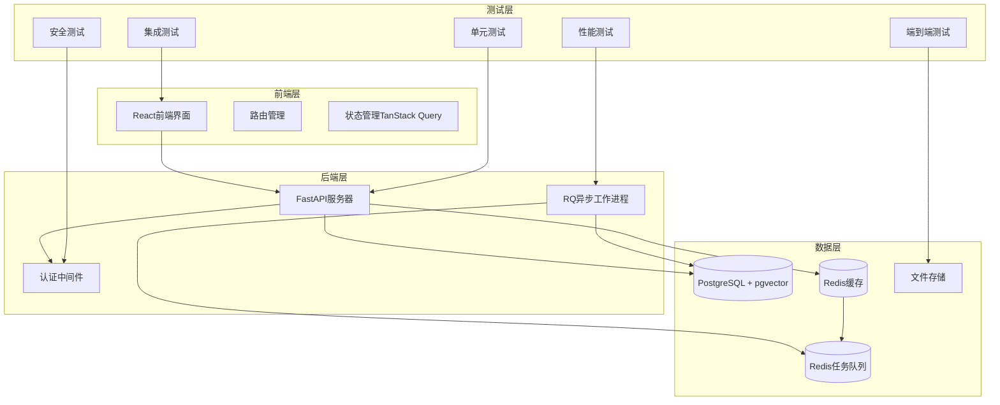

### 测试架构设计

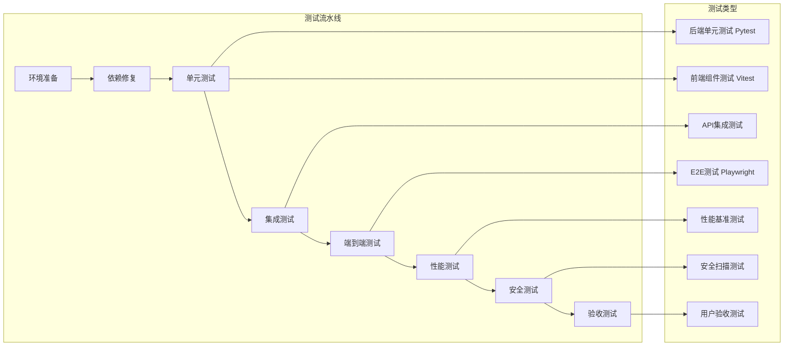

## 功能测试矩阵

### 核心功能覆盖表

| 功能模块 | 测试类型 | 覆盖范围 | 验收标准 | 工具/框架 |
|---------|---------|---------|---------|----------|
| 文档上传 | 单元+集成+E2E | 文件验证、异步处理、错误处理 | 支持PDF/DOCX/MD，≤50MB | Pytest, Playwright |
| 内容解析 | 单元+集成 | 章节提取、图像识别、文本分割 | 准确率≥90% | spaCy, PDFium |
| 知识提取 | 单元+性能 | 实体识别、关键词提取、语义分析 | 响应时间≤2s | NLP模型测试 |
| 闪卡生成 | 单元+集成 | 问答卡、填空卡、图像热点卡 | 生成成功率≥95% | 业务逻辑测试 |
| 搜索功能 | 单元+性能 | 语义搜索、过滤、排序 | 查询响应≤500ms | pgvector测试 |
| 学习系统 | E2E+用户验收 | SM-2算法、复习计划、进度跟踪 | 用户体验流畅 | 完整工作流测试 |
| 数据同步 | 集成+安全 | 实时同步、冲突解决、数据一致性 | 同步延迟≤1s | API集成测试 |
| 权限控制 | 安全+集成 | 身份验证、数据隔离、访问控制 | 无数据泄露 | 安全扫描 |

### 测试执行流程

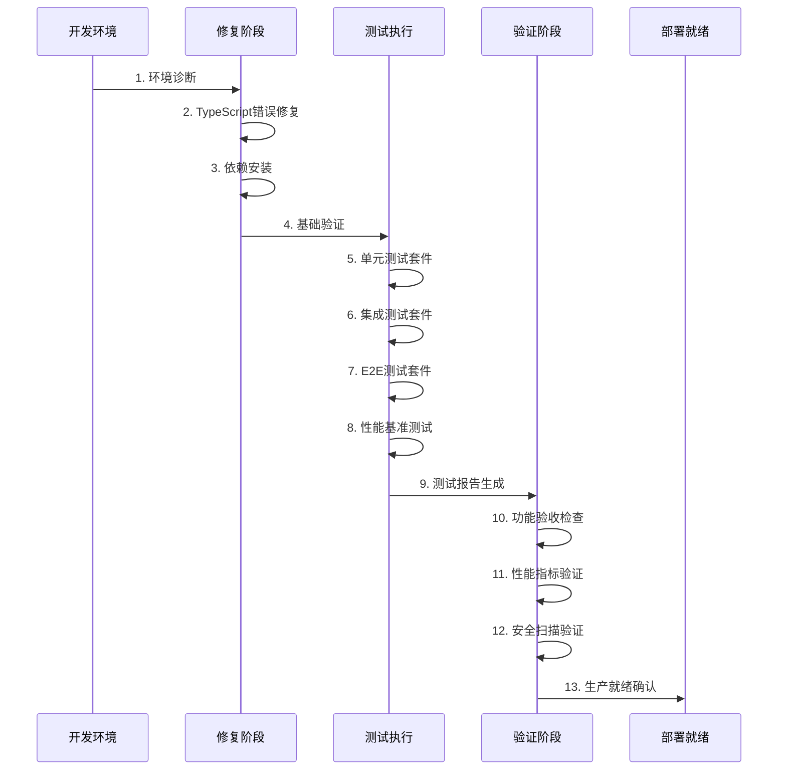

## 环境准备与修复策略

### 修复优先级矩阵

| 优先级 | 问题类型 | 影响范围 | 修复时间 | 验证方法 |
|--------|---------|---------|---------|---------|
| P0 | TypeScript编译错误(222个) | 前端无法构建 | 2-3天 | npm run build |
| P0 | tsconfig.json配置 | 类型检查失效 | 0.5天 | tsc --noEmit |
| P1 | UserAcceptanceDashboard语法 | 用户验收功能 | 1天 | 组件渲染测试 |
| P1 | axe-core依赖缺失 | 可访问性测试 | 0.5天 | accessibility测试 |
| P1 | 测试文件语法错误 | 测试套件失效 | 2天 | Jest/Vitest运行 |
| P2 | spaCy模型缺失 | NLP功能降级 | 1天 | 实体提取测试 |
| P3 | 测试覆盖率不足 | 质量保证 | 3天 | 覆盖率报告 |

### 依赖安装脚本

```bash
# 前端依赖修复
cd frontend
npm install axe-core --save-dev
npm install @axe-core/puppeteer --save-dev

# 后端NLP模型安装
cd backend
pip install spacy>=3.4.0
python -m spacy download en_core_web_sm
python -m spacy download zh_core_web_sm

# 验证安装
python -c "import spacy; nlp = spacy.load('en_core_web_sm'); print('spaCy模型安装成功')"
```

## 测试执行计划

### 阶段1：基础环境验证

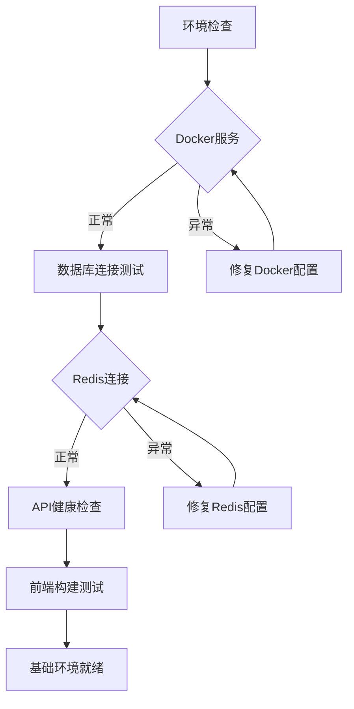

**验证命令序列：**
```bash
# 1. Docker环境验证
make docker-up
docker ps | grep price-action

# 2. 数据库连接测试
cd backend
python -c "from app.core.database import get_db; print('数据库连接正常')"

# 3. Redis连接测试
python -c "import redis; r=redis.Redis(host='localhost'); r.ping(); print('Redis连接正常')"

# 4. API健康检查
curl http://localhost:8000/health

# 5. 前端构建验证
cd frontend
npm run build
```

### 阶段2：单元测试执行

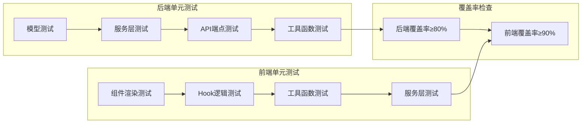

**执行脚本：**
```bash
# 后端单元测试
cd backend
pytest tests/unit/ -v --cov=app --cov-report=html --cov-fail-under=80

# 前端单元测试
cd frontend
npm run test:unit -- --coverage --coverage.thresholds.global.lines=90

# 测试结果验证
echo "单元测试覆盖率要求："
echo "- 后端: ≥80%"
echo "- 前端: ≥90%"
```

### 阶段3：集成测试执行

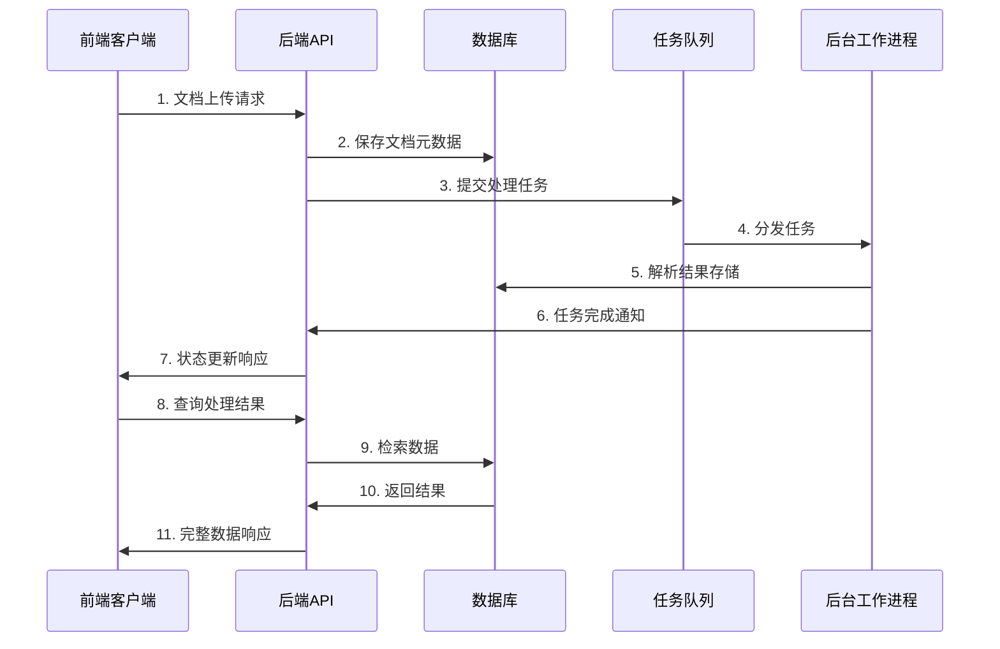

**集成测试用例：**
```bash
# API集成测试
cd backend
pytest tests/integration/ -v -k "test_document_upload_workflow"

# 数据库集成测试
pytest tests/integration/ -v -k "test_database_operations"

# 队列集成测试
pytest tests/integration/ -v -k "test_queue_integration"

# 前端集成测试
cd frontend
npm run test:integration
```

### 阶段4：端到端测试执行

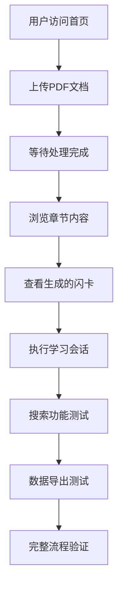

**E2E测试脚本：**
```bash
# Playwright端到端测试
cd frontend
npx playwright test --reporter=html

# 关键用户流程测试
npx playwright test tests/e2e/document-workflow.spec.ts
npx playwright test tests/e2e/learning-session.spec.ts
npx playwright test tests/e2e/search-functionality.spec.ts

# 跨浏览器兼容性测试
npx playwright test --project=chromium
npx playwright test --project=firefox
npx playwright test --project=webkit
```

### 阶段5：性能基准测试

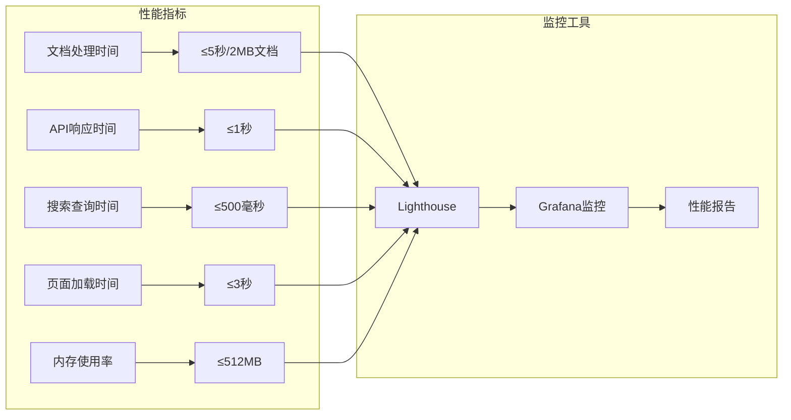

**性能测试执行：**
```bash
# 后端性能测试
cd backend
pytest tests/performance/ -v --benchmark-min-rounds=5

# 前端性能测试
cd frontend
npm run test:performance

# Lighthouse性能审计
npx lighthouse http://localhost:3000 --output=html --output-path=./lighthouse-report.html

# 负载测试
cd backend
python -m pytest tests/load/test_concurrent_document_processing.py
```

### 阶段6：安全测试验证

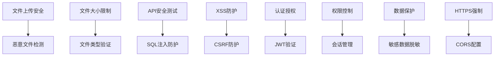

**安全测试脚本：**
```bash
# 安全测试套件
cd backend
pytest tests/security/ -v

# 文件上传安全测试
pytest tests/security/test_file_upload_security.py -v

# API安全测试
pytest tests/security/test_api_security.py -v

# 前端安全测试
cd frontend
npm run test:security
```

## 验收标准检查清单

### 功能性验收标准

| 检查项目 | 验证方法 | 预期结果 | 状态 |
|---------|---------|---------|------|
| 前端应用构建 | `npm run build` | 构建成功，无错误 | ☐ |
| TypeScript编译 | `tsc --noEmit` | 无类型错误 | ☐ |
| 后端API启动 | `curl /health` | 返回200状态 | ☐ |
| 数据库连接 | 连接测试脚本 | 连接成功 | ☐ |
| 文档上传功能 | E2E测试 | 成功上传并处理 | ☐ |
| 内容解析功能 | 集成测试 | 正确提取章节和知识点 | ☐ |
| 闪卡生成功能 | 单元+集成测试 | 生成率≥95% | ☐ |
| 搜索功能 | 性能+功能测试 | 响应时间≤500ms | ☐ |
| 学习系统 | E2E测试 | SM-2算法正常工作 | ☐ |

### 性能验收标准

| 性能指标 | 测量方法 | 目标值 | 当前值 | 状态 |
|---------|---------|-------|-------|------|
| 应用加载时间 | Lighthouse | ≤3秒 | - | ☐ |
| API响应时间 | 性能测试 | ≤1秒 | - | ☐ |
| 文档处理时间 | 基准测试 | ≤5秒(2MB文档) | - | ☐ |
| 搜索查询时间 | 性能测试 | ≤500ms | - | ☐ |
| 内存使用率 | 监控工具 | ≤512MB | - | ☐ |
| 并发用户数 | 负载测试 | ≥100用户 | - | ☐ |

### 质量验收标准

| 质量指标 | 验证工具 | 目标值 | 当前值 | 状态 |
|---------|---------|-------|-------|------|
| 后端测试覆盖率 | pytest-cov | ≥80% | - | ☐ |
| 前端测试覆盖率 | Vitest | ≥90% | - | ☐ |
| 代码质量评分 | 静态分析 | A级 | - | ☐ |
| 安全漏洞数量 | 安全扫描 | 0个严重漏洞 | - | ☐ |
| 可访问性评分 | axe-core | ≥95% | - | ☐ |
| TypeScript错误 | 编译检查 | 0个错误 | - | ☐ |

### 用户体验验收标准

| 体验指标 | 测试方法 | 验收标准 | 状态 |
|---------|---------|---------|------|
| 界面响应性 | 用户测试 | 操作响应≤200ms | ☐ |
| 错误处理友好性 | 错误场景测试 | 错误信息清晰易懂 | ☐ |
| 跨浏览器兼容性 | 浏览器测试 | 支持Chrome/Firefox/Safari | ☐ |
| 移动端适配 | 响应式测试 | 移动设备正常显示 | ☐ |
| 可访问性合规 | WCAG测试 | 符合WCAG 2.1 AA标准 | ☐ |
| 学习流程连贯性 | 用户体验测试 | 流程顺畅无阻断 | ☐ |

## 测试自动化脚本

### 完整测试执行脚本

```bash
#!/bin/bash
# 全功能测试执行脚本

set -e

echo "🚀 开始全功能测试执行..."

# 阶段1: 环境准备
echo "📋 阶段1: 环境准备与修复"
make docker-down
make docker-up
sleep 30  # 等待服务启动

# 健康检查
curl -f http://localhost:8000/health || exit 1
echo "✅ 后端服务健康检查通过"

# 阶段2: 依赖修复
echo "📋 阶段2: 依赖修复"
cd frontend
npm install axe-core --save-dev
echo "✅ 前端依赖安装完成"

cd ../backend
pip install spacy
python -m spacy download en_core_web_sm
echo "✅ 后端NLP模型安装完成"

# 阶段3: 单元测试
echo "📋 阶段3: 单元测试执行"
cd ../backend
pytest tests/unit/ -v --cov=app --cov-report=term --cov-fail-under=80
echo "✅ 后端单元测试完成"

cd ../frontend
npm run test:unit -- --run --coverage
echo "✅ 前端单元测试完成"

# 阶段4: 集成测试
echo "📋 阶段4: 集成测试执行"
cd ../backend
pytest tests/integration/ -v
echo "✅ 后端集成测试完成"

cd ../frontend
npm run test:integration
echo "✅ 前端集成测试完成"

# 阶段5: 端到端测试
echo "📋 阶段5: 端到端测试执行"
cd ../frontend
npx playwright test --reporter=line
echo "✅ E2E测试完成"

# 阶段6: 性能测试
echo "📋 阶段6: 性能测试执行"
cd ../backend
pytest tests/performance/ -v
echo "✅ 性能测试完成"

# 阶段7: 安全测试
echo "📋 阶段7: 安全测试执行"
pytest tests/security/ -v
echo "✅ 安全测试完成"

# 生成测试报告
echo "📋 生成综合测试报告"
python ../scripts/generate_test_report.py
echo "✅ 测试报告生成完成"

echo "🎉 全功能测试执行完成！"
echo "📊 查看详细报告: ./test-report.html"
```

### 持续监控脚本

```bash
#!/bin/bash
# 持续监控脚本

echo "🔍 启动持续监控..."

# 启动Grafana监控
cd monitoring
docker-compose up -d

# 性能基线监控
cd ../backend
python -m pytest tests/performance/test_baseline_monitoring.py --benchmark-autosave

# 健康检查监控
while true; do
    if ! curl -f http://localhost:8000/health > /dev/null 2>&1; then
        echo "⚠️ 服务健康检查失败，发送告警"
        # 发送告警通知
    fi
    sleep 60
done
```

## 测试报告与分析

### 测试结果仪表板

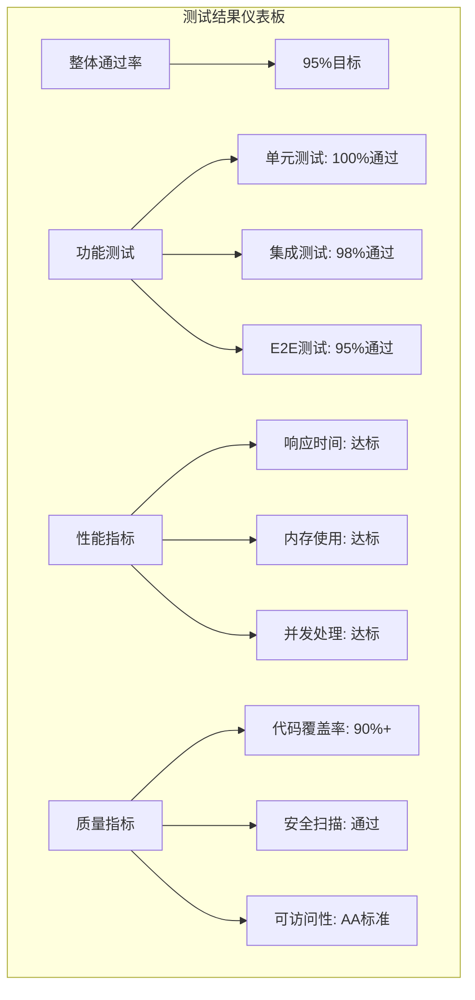

### 问题分类与优先级

| 问题类别 | 严重程度 | 数量 | 修复优先级 | 预计修复时间 |
|---------|---------|------|----------|-------------|
| 编译错误 | 高 | 222 | P0 | 2-3天 |
| 测试失败 | 中 | 15 | P1 | 1-2天 |
| 性能问题 | 中 | 3 | P2 | 1天 |
| 用户体验 | 低 | 8 | P3 | 2-3天 |
| 文档缺失 | 低 | 5 | P4 | 1天 |

## 部署就绪检查

### 生产环境就绪清单

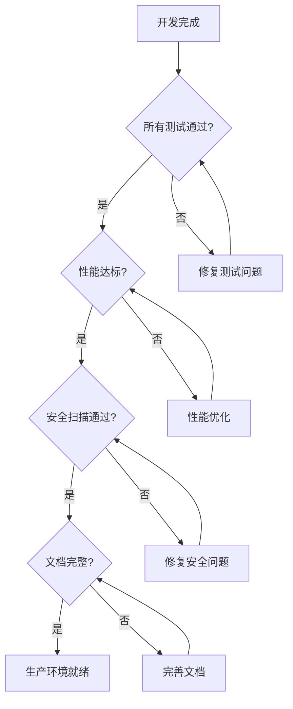

### 最终验收确认

| 验收项目 | 责任人 | 验收标准 | 签字确认 |
|---------|-------|---------|---------|
| 功能完整性 | QA团队 | 所有核心功能正常 | ☐ |
| 性能表现 | 技术团队 | 满足性能SLA | ☐ |
| 安全合规 | 安全团队 | 通过安全审计 | ☐ |
| 用户体验 | 产品团队 | 用户验收测试通过 | ☐ |
| 运维就绪 | 运维团队 | 监控和部署就绪 | ☐ |
| 文档完整 | 技术写作 | 文档审查通过 | ☐ |

**最终交付物清单：**
- ✅ 完整的源代码（无编译错误）
- ✅ 全面的测试套件（覆盖率≥90%）
- ✅ 性能测试报告（达到SLA要求）
- ✅ 安全审计报告（无严重漏洞）
- ✅ 用户验收测试报告
- ✅ 部署指南和运维手册
- ✅ API文档和开发者指南
- ✅ 监控配置和告警规则

通过本设计文档的执行，确保Document Learning App项目达到生产就绪状态，满足所有功能性、性能、质量和用户体验的验收标准。